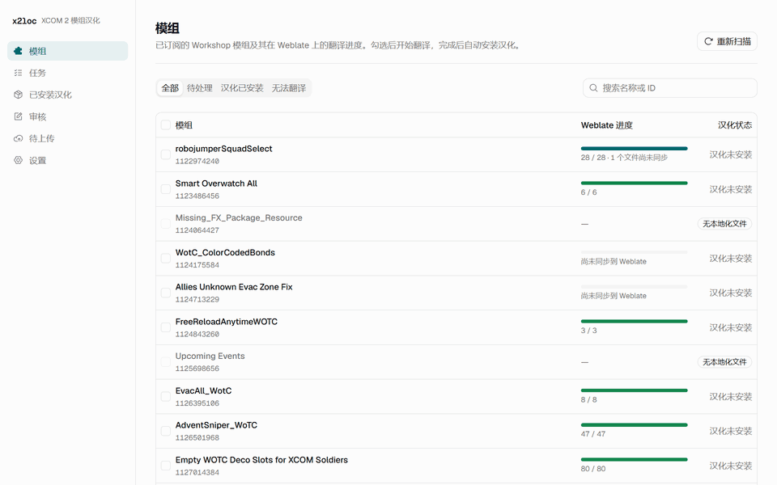
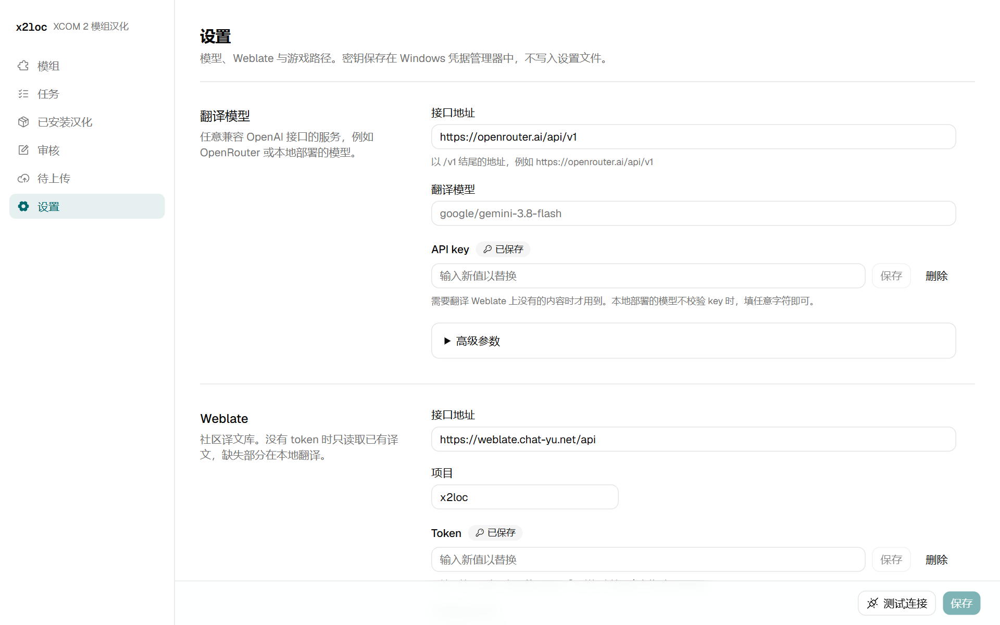
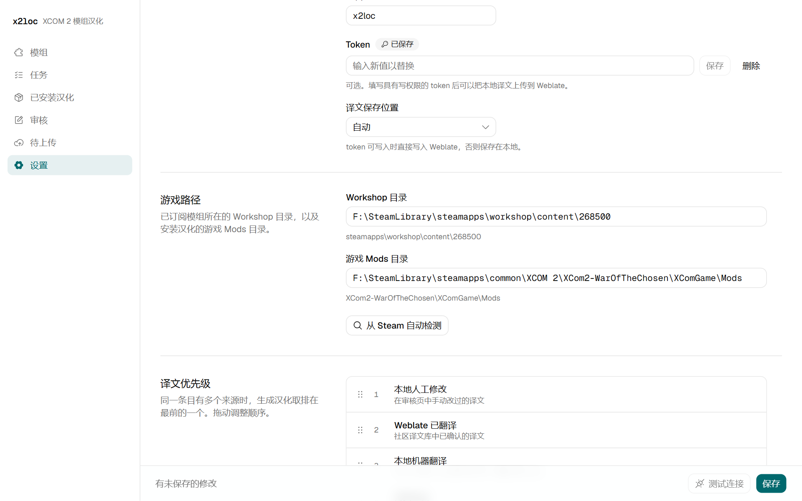
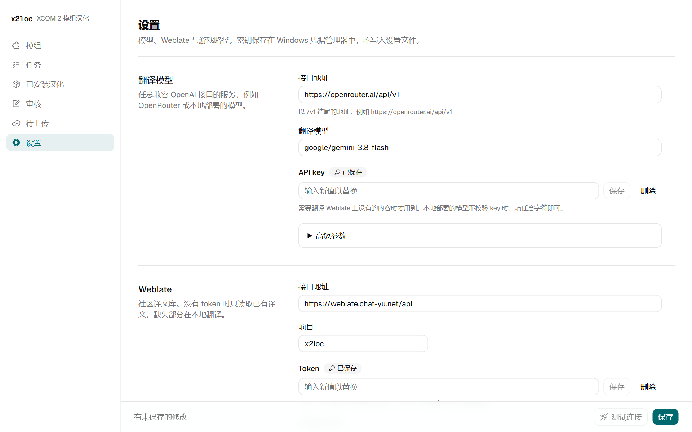
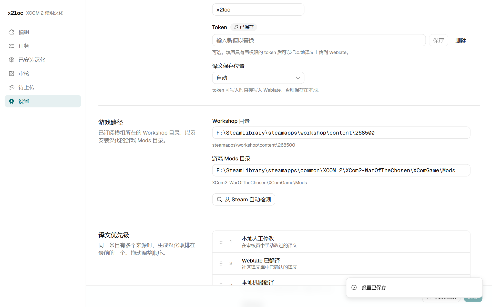
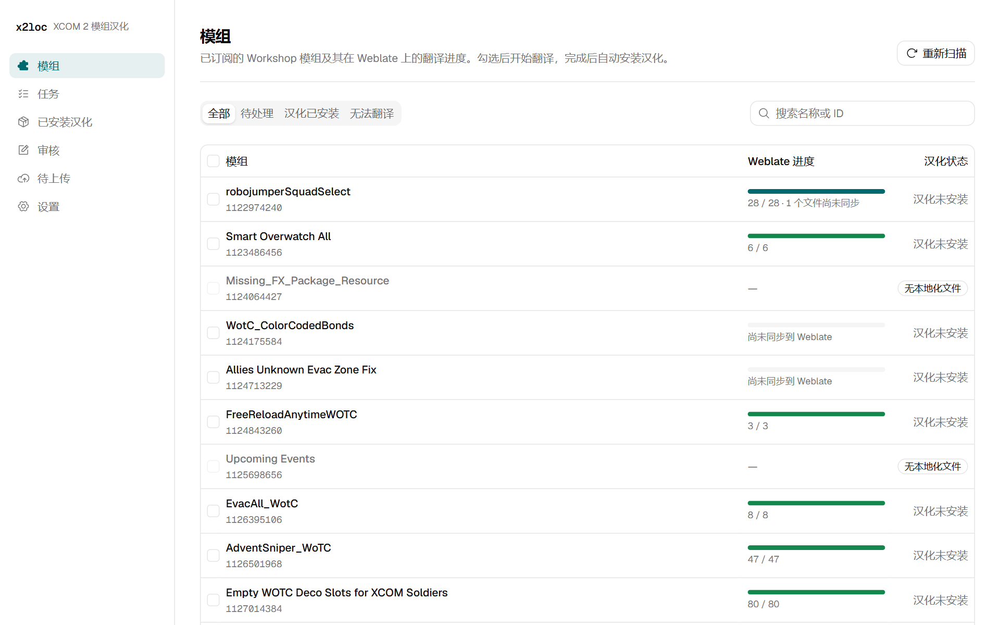
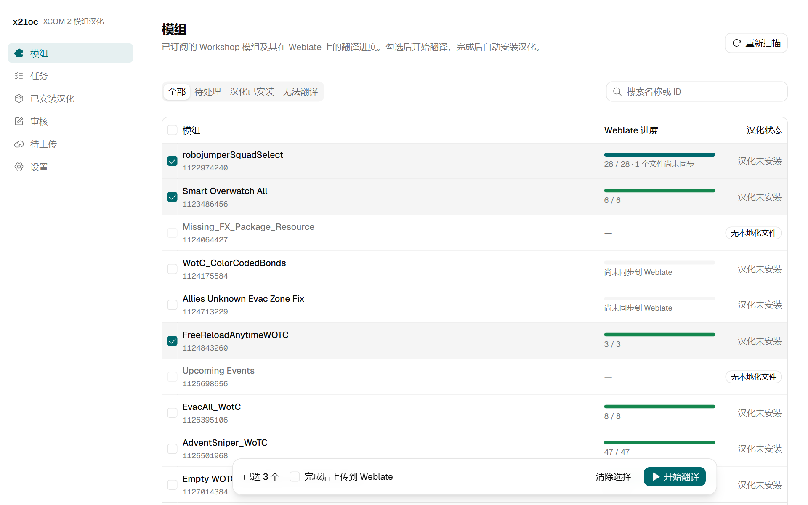
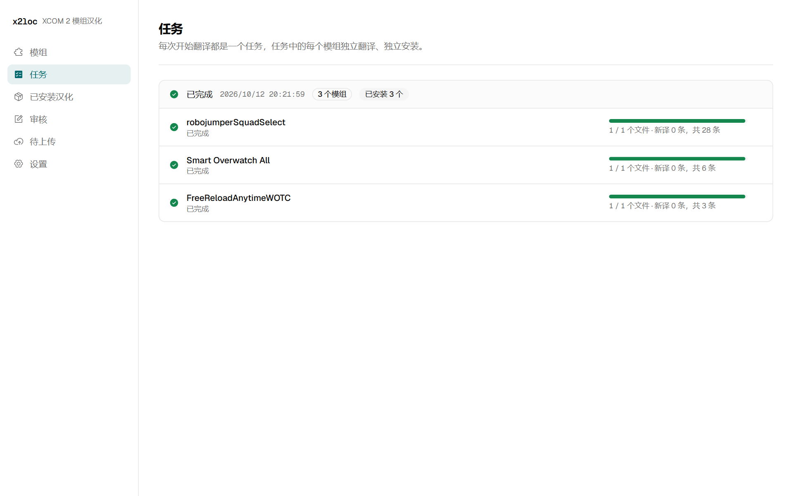
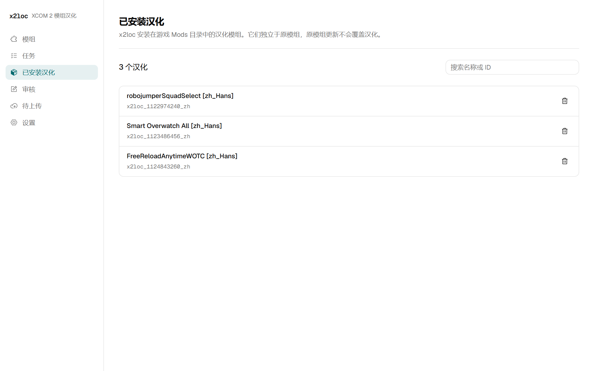

# x2loc 使用教程

x2loc 为《XCOM 2：天选者之战》已订阅的 mod 安装中文汉化。它优先使用社区 Weblate 译文库中已有的译文，只有译文库中缺少的文本才调用你自己的大语言模型（LLM）翻译；每个汉化都安装为独立的 mod，原 mod 更新时不会被覆盖。

## 准备

- Windows 10 或 11，以及 Steam 版《XCOM 2》与“天选者之战”资料片。
- 可选：一个 OpenAI 兼容接口的 API key，例如 [OpenRouter](https://openrouter.ai/)。所选 mod 在译文库中已全部译完时不需要它；需要翻译新文本时才会用到，费用由该接口按用量收取。
- 可选：社区 Weblate 的 token。只读取译文时不需要；有写权限的 token 可以把你翻译的译文上传，供其他玩家使用。

## 一、下载与启动

1. 从 [Releases](https://github.com/ITOTI-Y/x2loc/releases) 下载最新的 `x2loc.exe`，放在任意文件夹中。
2. 双击运行。Windows 可能提示“Windows 已保护你的电脑”，这是因为程序没有代码签名；点击“更多信息”，再点击“仍要运行”即可。
3. 程序打开一个控制台窗口，并在浏览器中打开 x2loc 页面。使用期间保持控制台窗口打开，关闭该窗口即退出程序。

第一次启动需要解压运行文件，会比之后慢几秒。设置、本地译文和日志保存在 `%LOCALAPPDATA%\x2loc\` 中。

## 二、首次设置

第一次打开时，页面直接进入“设置”。

### 游戏路径

点击“从 Steam 自动检测”，程序会从 Steam 的库文件夹中找到两个路径：已订阅 mod 所在的 Workshop 目录，以及安装汉化用的游戏 Mods 目录。检测失败时，也可以手动填写这两个路径。

只设置游戏路径就可以开始使用：译文库中已经译完的 mod 不需要模型。

### 翻译模型与 API key

需要翻译译文库中没有的文本时，填写以下三项：

- 接口地址：OpenAI 兼容接口的地址，以 `/v1` 结尾，默认为 OpenRouter。
- 翻译模型：接口提供的模型名称。
- API key：填入后点击右侧的“保存”，key 保存在 Windows 凭据管理器中，页面上只显示“已保存”或“未设置”。本地部署的模型不校验 key 时，填任意字符即可。

填写完成后点击底部的“保存”，再点击“测试连接”，页面会分别显示模型接口和 Weblate 是否可用，以及 token 是只读还是可写。

“高级参数”中的并发请求数、批大小等保持默认即可，各项含义见字段下方的说明。

### 译文优先级

同一条文本可能同时有 Weblate 译文、本地机器译文和 mod 自带的中文。生成汉化时取列表中排在最前的一个，可以拖动调整顺序，“原文”固定在最后。一般保持默认顺序即可。

## 三、选择 mod 并翻译

进入“模组”页，程序会列出 Workshop 目录中的全部 mod，并在后台读取它们在 Weblate 上的翻译进度。

- “Weblate 进度”显示已翻译条目数与总条目数；“尚未同步到 Weblate”表示译文库中还没有这个 mod，翻译时需要用到模型。
- “汉化状态”显示该 mod 的汉化是否已安装到游戏 Mods 目录。
- 上方的“待处理”筛选出尚未译完或尚未安装汉化的 mod；“无法翻译”是不含本地化文本的 mod。

勾选要汉化的 mod，点击底部的“开始翻译”。设置了可写的 Weblate token 时，还可以勾选“完成后上传到 Weblate”。

## 四、查看任务

开始翻译后页面切换到“任务”。每个 mod 独立翻译、独立安装，一个 mod 失败不影响其他 mod；失败时，状态行会显示原因，例如“该 mod 有需要翻译的条目，请先在设置中填写翻译模型和 API key”。

## 五、在游戏中启用汉化

“已安装汉化”页列出 x2loc 安装的全部汉化 mod，文件夹名为 `x2loc_<创意工坊 ID>_zh`；点击右侧的删除图标即可卸载某个汉化。

打开 mod 启动器，例如 Alternative Mod Launcher（AML），勾选这些汉化 mod，并保持原 mod 也处于启用状态，然后启动游戏。汉化位于游戏的 Mods 目录中，加载时排在创意工坊 mod 之后，因此会覆盖原 mod 的英文文本。

## 六、审核与上传（可选）

- 审核：质量检查未通过的译文会出现在“审核”页。可以直接修改译文，或在确认无误后点击“确认无误”；有可写 token 时修改直接提交到 Weblate，否则保存在本地。
- 待上传：没有 token 时翻译和修改的译文都保存在本地，并列在“待上传”页。之后填入有写权限的 token，即可选择组件上传；上传前程序会核对 Weblate 上的当前译文，被他人改过的条目标为冲突，由你选择保留哪一份。

## 常见问题

**没有 API key 能用吗？**
能。所选 mod 在译文库中已全部译完时，任务只下载已有译文并安装汉化，完全不调用模型。

**翻译要花多少钱？**
取决于所选模型的单价和需要翻译的条目数。译文库中已有的条目不产生费用，所以使用的人越多、贡献的译文越多，每个人需要自己翻译的部分越少。

**原 mod 更新后怎么办？**
在“模组”页重新勾选该 mod 并开始翻译。新版本的汉化会替换旧版本，原文改动过的条目会重新翻译。

**杀毒软件报毒怎么办？**
`x2loc.exe` 由 Nuitka 打包为单个可执行文件，部分杀毒软件会误报这一类程序。程序源码与构建过程都公开在本仓库中，Release 由 GitHub Actions 自动构建。

**如何彻底卸载？**
在“已安装汉化”页删除全部汉化，然后删除 `x2loc.exe` 和 `%LOCALAPPDATA%\x2loc\` 文件夹；如需清除密钥，在 Windows 凭据管理器的“Windows 凭据”中删除名称为 `x2loc` 或以 `@x2loc` 结尾的普通凭据。
